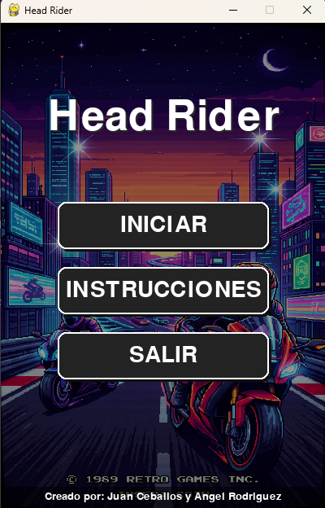
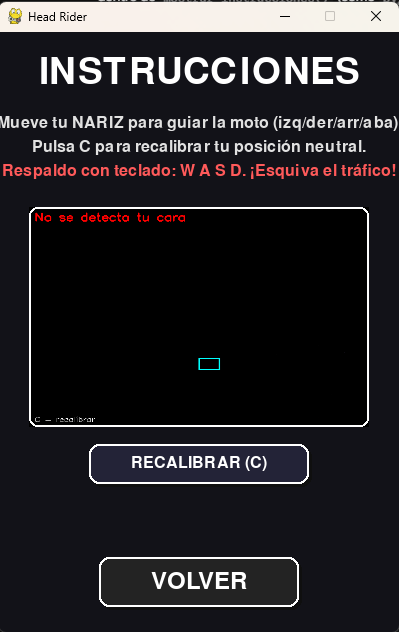

# Head Rider — Documentación Técnica del Proyecto

**Head Rider** es un videojuego arcade 2D de carreras y esquive en **un solo jugador**, desarrollado en Python con **Pygame**, **OpenCV** y **MediaPipe**. Su interfaz combina una estética *pixel art* nocturna en el menú principal con pantallas de calibración visual, control de la moto mediante el seguimiento de la **punta de la nariz** y respaldo por teclado (`W A S D`).

> **Autores:** Juan Ceballos y Angel Rodriguez.

---

## 1. Estructura del Repositorio y Módulos

El proyecto está organizado de forma modular en la raíz del repositorio junto a la carpeta de recursos y documentación.

```text
head_rider/
├── assets/                        # Imágenes, pistas de audio, modelo MediaPipe y capturas
├── __pycache__/                   # Caché de bytecode compilado por Python
├── carros.py                      # Clases Carro y Generador de tráfico
├── escenarios.py                  # Clase Escenario (3 carriles, temas y animación)
├── motos.py                       # Clase Moto (sprite, movimiento y hitbox)
├── trafic_raider.py               # Punto de entrada, cámara/MediaPipe, UI y bucle principal
├── GDD_Head_Rider_Actualizado.docx # Game Design Document actualizado
└── README.md                      # Documentación técnica del proyecto
```

### Responsabilidad de cada archivo

- **`trafic_raider.py`:** Inicializa Pygame (`400x600` a `60 FPS`), gestiona la precarga y el hilo de `ControlCabeza`, controla los estados de interfaz (`mostrar_menu`, `mostrar_instrucciones`, `iniciar_juego`, `mostrar_ganador`), aplica los controles (`Manage_head` y `Manage_keys`), evalúa las colisiones (`detectar_colision`) y administra el ciclo de vida de la partida.

- **`motos.py`:** Define la clase `Moto` (`50x100` px, velocidad base de `6` px/frame), carga el sprite (`motorcycle_<color>.png` con respaldo rectangular), dibuja la moto y sincroniza su `pygame.Rect` (`self.rect`) mediante `actualizar_hit_box()`.

- **`carros.py`:** Define `Carro` (`75x100` px, velocidad base `1.0`, rotación de `180°` sobre sprites aleatorios de `stilos`, `self.rect` y `movimiento(aumento)`) y `Generador` (calcula intervalos decrecientes cada 10 s desde `2000` ms hasta un mínimo de `800` ms, centra vehículos en los 3 carriles desde `y = -100`, aplica incremento gradual de velocidad cada 15 s hasta `+1.0` y depura carros con `y >= 700`).

- **`escenarios.py`:** Define `Escenario`, que divide el ancho en 3 carriles (`carril_ancho = ancho // 3`), administra los temas `"clasico"`, `"noche"` y `"desierto"` (colores de fondo, líneas y bordes), anima las líneas discontinuas (`velocidad_lineas = 3`) y dibuja la pista y sus bordes laterales.

- **`assets/`:** Contiene las imágenes del juego (`Fondo.jpg`, `captura_menu.png`, `captura_instrucciones.png`, sprites de motos y carros), los audios (`wait.wav`, `tokyo_drift.wav`, `dead.wav`) y el modelo de detección facial `face_landmarker.task`.

---

## 2. Interfaz y Modos de Juego

### 2.1 Menú Principal



La ventana principal (`400x600`) muestra el título **Head Rider** sobre un escenario urbano nocturno en *pixel art* con motos en carretera, un pie de página con los créditos y tres botones interactivos con efecto *hover* (`dibujar_boton`).

- **INICIAR:** Inicia el modo de juego en **1 solo jugador**, reproduce en bucle `tokyo_drift.wav` y utiliza el seguimiento por cámara/nariz (con respaldo `W A S D`).

- **INSTRUCCIONES:** Abre la pantalla de guía y prueba de cámara, donde se verifica la disponibilidad de la cámara y se calibra el punto neutral de seguimiento (la punta de la nariz).

- **SALIR:** Cierra la aplicación, detiene el audio y libera los recursos de cámara y MediaPipe.

### 2.2 Pantalla de Instrucciones y Calibración



Permite verificar el seguimiento facial y calibrar la postura neutral antes de iniciar la carrera.

- **Guía en pantalla:** Indica mover la **nariz** (izquierda, derecha, arriba y abajo), usar `C` para recalibrar el centro neutral y emplear `W A S D` como respaldo por teclado.

- **Visor de cámara en vivo:** Renderiza la captura de cámara dentro de la ventana de Pygame (`obtener_superficie_pygame`) con un punto verde sobre la nariz, un rectángulo de zona muerta alrededor del centro calibrado y mensajes de estado (*"Calibrando... mira al frente"*, *"No se detecta tu cara"* y *"C = recalibrar"*).

- **RECALIBRAR (C):** Reinicia `centro` y `muestras` para volver a calcular el punto neutral.

- **VOLVER:** Regresa al **Menú Principal** (también con la tecla `ESC`).

### 2.3 Modo de Juego (Un Solo Jugador)

- **Conducción:** Control de la moto en 1 jugador mediante la nariz (`Manage_head`) o las teclas `W`, `A`, `S`, `D` (`Manage_keys`), restringido a los bordes de la ventana mediante `limitar_moto()`.

- **Progresión y puntajes:** El puntaje (`tiempo_transcurrido` en segundos) se muestra en la esquina superior izquierda (`Puntaje: 000`); el factor `aumento` de velocidad del tráfico sube de `2` (primeros 10 s) a `min((tiempo_transcurrido // 10) + 3, 7)`, y el escenario cambia de tema automáticamente cada `10000` ms (`10` s) o manualmente con `ESPACIO`.

- **Fin de partida:** Al chocar con un vehículo enemigo (`detectar_colision`), se detiene `tokyo_drift.wav` y se abre la pantalla final (`mostrar_ganador`) con `dead.wav`, el puntaje alcanzado y el botón **Volver al menú**.

---

## 3. Funcionamiento Técnico de `trafic_raider.py`

### 3.1 Manejo de la Cámara y Seguimiento por Nariz

La integración de la cámara se apoya en la precarga en segundo plano, la clase `ControlCabeza` y las funciones de movimiento.

1. **Precarga e hilo independiente (`precargar_camara` y `ControlCabeza.iniciar`):**

   Al arrancar el programa, `precargar_camara()` lanza un hilo que instancia `ControlCabeza(INDICE_CAMARA)` e inicia `self._bucle` en un hilo *daemon*. Así, la captura y el procesamiento de video no bloquean el bucle principal de Pygame a `60 FPS`.

2. **Captura, modelo y detección (`__init__` y `_bucle`):**

   - Abre la cámara con OpenCV (`CAP_DSHOW` en Windows cuando está disponible, resolución `640x480`) y verifica/descarga `face_landmarker.task` mediante `asegurar_modelo()` para inicializar `vision.FaceLandmarker` en modo `VIDEO` (`num_faces=1`).
   - En cada iteración de `_bucle`, espeja el cuadro con `cv2.flip(frame, 1)` para que izquierda y derecha sean naturales, convierte de `BGR` a `RGB`, genera una marca de tiempo monotónica (`ts`) y ejecuta `self.landmarker.detect_for_video(imagen, ts)`.
   - Extrae el *landmark* `1` (`resultados.face_landmarks[0][1]`, punta de la nariz) con coordenadas normalizadas `(x, y)`.

3. **Suavizado, calibración y zona muerta (`_bucle`, `recalibrar`, `_eje`, `obtener_movimiento`):**

   - Aplica suavizado exponencial con `SUAVIZADO = 0.5` sobre la posición de la nariz.
   - Acumula `MUESTRAS_CALIBRACION = 20` muestras iniciales cuando `self.centro` es `None` para promediar la posición neutral; al pulsar `C` o el botón de recalibrar, `recalibrar()` limpia `centro` y `muestras` para repetir el proceso.
   - En `obtener_movimiento()`, calcula la diferencia respecto al centro calibrado y pasa cada eje por `_eje(delta, zona, rango)`: ignora desplazamientos menores a `ZONA_MUERTA_X` (`0.03`) o `ZONA_MUERTA_Y` (`0.025`) y normaliza el resto entre `-1.0` y `1.0` según `RANGO_X` (`0.10`) y `RANGO_Y` (`0.07`).

4. **Aplicación a la moto y visualización (`Manage_head`, `obtener_superficie_pygame`, `mostrar_camara`):**

   - `Manage_head(control, moto)` desplaza `moto.x` y `moto.y` sumando `dx * moto.velocidad` y `dy * moto.velocidad`, y llama a `limitar_moto(moto)` para mantenerla dentro de `(0..Ancho, 0..Alto)` y actualizar `moto.rect`.
   - En `mostrar_instrucciones()` se convierte el *frame* a superficie de Pygame con `obtener_superficie_pygame()`, y en `iniciar_juego()` se invoca `mostrar_camara()` en el hilo principal cuando la cámara está disponible.

### 3.2 Detección de Colisiones y Pérdida de la Partida

- **Función `detectar_colision(carros, moto)`:** Recorre la lista `carros` recibida y evalúa `carro.rect.colliderect(moto.rect)` entre el rectángulo de colisión del carro y el rectángulo de la moto; devuelve `True` en cuanto detecta intersección y `False` si no hay choque.

- **Evaluación en `iniciar_juego()`:** Dentro del bucle principal, tras actualizar y dibujar cada `enemigo` (y avanzar su posición vertical con `enemigo.movimiento(aumento)`), se comprueba:

```python
if detectar_colision([enemigo], moto):
    pygame.mixer.music.stop()
    return mostrar_ganador(
        Ancho, Alto, Ventana, BLANCO, NEGRO,
        tiempo_transcurrido
    )
```

Si `detectar_colision` retorna `True`, se detiene la música de la partida (`tokyo_drift.wav`) y se invoca `mostrar_ganador(...)` pasando `tiempo_transcurrido` como puntaje final, dando por finalizada la partida.

---
